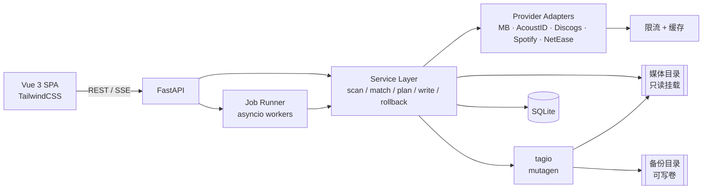
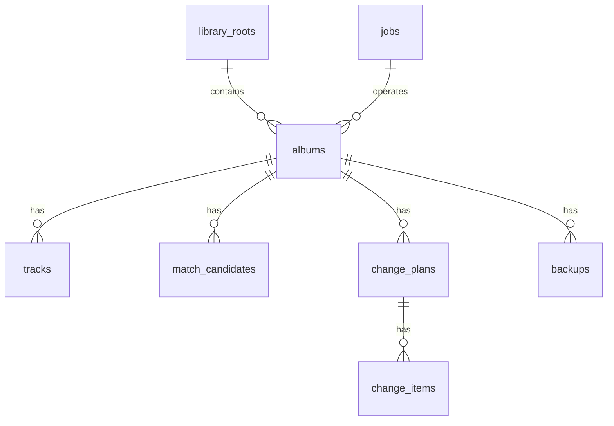
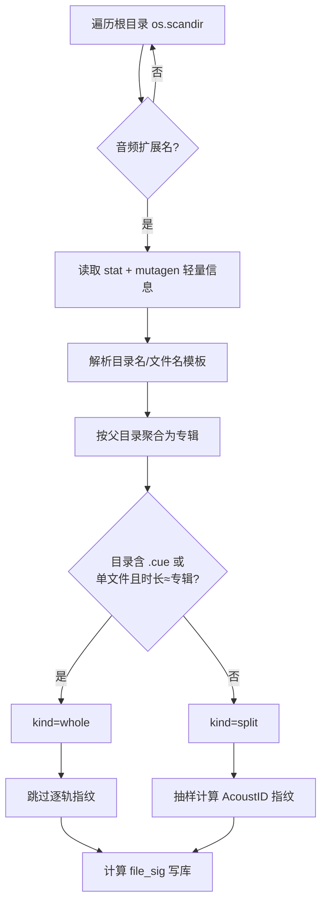
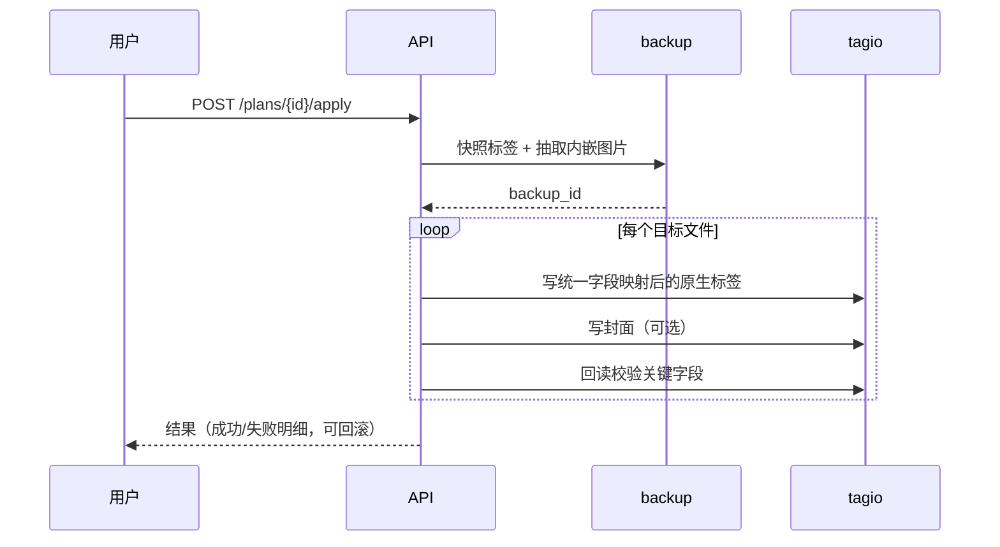

# music-scrap 设计文档

| 项目 | 内容 |
|---|---|
| 状态 | 待评审 |
| 版本 | v0.1 |
| 日期 | 2026-11-16 |
| 范围 | 整轨/分轨音乐文件元数据刮削、封面设置 |
| 技术栈 | 前端 Vue 3 + TailwindCSS + Tailwind UI 组件模式；后端 Python |

---

## 1. 背景与目标

本地音乐库常见两类组织方式：

- **分轨（track-per-file）**：一张专辑拆成多个音频文件，每个文件需要独立的曲名、艺术家、轨号、ISRC 等标签。
- **整轨（single-file album）**：整张专辑是一个音频文件，通常配套 `.cue` 表描述分轨信息。

两类文件的元数据与封面长期依赖手工填写，来源分散、格式不统一。本项目提供一个常驻在 NAS/服务器上的 Web 工具，集中完成**扫描、识别、多源刮削、预览确认、写入、回滚**。

### 1.1 目标

1. 扫描配置的音乐库根目录，自动识别专辑并区分**整轨**与**分轨**。
2. 聚合 MusicBrainz + AcoustID、Discogs、Spotify、网易云/QQ 音乐的数据源，给出候选匹配。
3. 以「当前值 vs 新值」的差异预览方式让用户确认后再写入，写入前自动备份，支持回滚。
4. 下载并设置封面：内嵌到音频标签，同时落盘 `cover.jpg`。
5. 单容器部署，浏览器多设备访问，无需登录。

### 1.2 非目标

- 不做音乐播放、转码、格式转换。
- 不做 CUE 分割：整轨文件不拆分为分轨音频。
- 不做多用户账号与权限体系（单用户工具）。
- 不做音乐文件重命名/目录重组。
- 不做移动端原生 App，只提供响应式 Web。
- 不做定时自动扫描，扫描由用户手动触发。

### 1.3 成功标准

- 对 ≥ 90% 的常规命名目录（`Artist/Album/Track.flac`）能自动找到高于阈值的最佳候选。
- 任意一次批量写入都可完整回滚到写入前状态。
- 5 万文件首次全量扫描在 30 分钟内完成（不含远程检索），并支持中断续跑。
- 整轨文件只写专辑级字段，不破坏 CUE 文件与音轨结构。

---

## 2. 术语

| 术语 | 含义 |
|---|---|
| 整轨 | 单文件承载整张专辑，配套或不配套 `.cue` |
| 分轨 | 一张专辑由多个音频文件组成 |
| 变更计划（Change Plan） | 一次刮削产生的待写入字段集合，可逐项编辑后再应用 |
| 备份快照（Backup Snapshot） | 写入前保存的完整标签与内嵌图片，用于回滚 |
| Provider | 外部元数据/封面数据源适配器 |
| 指纹 | Chromaprint 生成、AcoustID 查询的音频指纹 |

---

## 3. 需求

### 3.1 功能需求

| ID | 需求 |
|---|---|
| FR-1 | 管理多个库根目录，支持新增、停用、重新扫描 |
| FR-2 | 扫描时识别文件类型、时长、大小、内嵌标签、`.cue` 存在性 |
| FR-3 | 自动分组为专辑，并标注 `whole`（整轨）/ `split`（分轨） |
| FR-4 | 支持按目录名/文件名模板解析出 artist、album、year、track 等线索 |
| FR-5 | 多 Provider 并行检索，合并去重候选，按置信度排序 |
| FR-6 | 分轨可用 AcoustID 逐轨指纹投票确定专辑；整轨跳过逐轨指纹 |
| FR-7 | 支持手动关键词重新搜索并手动指定候选 |
| FR-8 | 生成字段级差异预览，允许逐项编辑/跳过 |
| FR-9 | 应用写入前自动备份，写入后回读校验 |
| FR-10 | 支持按专辑或按批次回滚 |
| FR-11 | 封面多候选展示、预览、选择，写入标签并落盘 `cover.jpg` |
| FR-12 | 任务进度实时推送（SSE），可取消，重启后可续跑 |
| FR-13 | 记录操作历史与审计日志 |
| FR-14 | 配置各 Provider 凭据、限流、开关与字段优先级 |

### 3.2 非功能需求

| 维度 | 要求 |
|---|---|
| 规模 | < 5 万文件；单库建议 < 2 万 |
| 并发 | 扫描 1 个、远程检索 3 路、写入串行（每文件加锁） |
| 可用性 | 单进程异常退出后重启可恢复未完成任务 |
| 数据安全 | 写入前必备份；路径越界拦截；凭据加密存储 |
| 可观测性 | 结构化日志 + 任务级追踪 ID + 健康检查 |
| 部署 | 单容器，媒体目录可只读挂载，备份目录独立可写 |

### 3.3 约束与假设

- 外部 API 有频率限制，系统吞吐上限由 Provider 限流决定，而非本地 CPU。
- 网易云/QQ 音乐无稳定公开 API，适配器默认关闭，需用户显式开启并自担合规风险。
- Tailwind UI 为商业模板，本项目只采用其公开的 **Headless UI + Heroicons** 组合模式自建组件，不复制付费源码。
- 单用户部署，前端与后端同源，不实现登录与 CSRF 令牌。

---

## 4. 总体架构

采用**方案 A：单体 FastAPI + SQLite + 进程内异步任务执行器 + Vue 3 SPA**。



### 4.1 技术选型

| 层 | 选型 | 理由 |
|---|---|---|
| Web 框架 | FastAPI + Uvicorn | 异步、SSE 原生支持、OpenAPI 自动文档 |
| ORM/迁移 | SQLAlchemy 2.x + Alembic | 类型友好，迁移可控 |
| 数据库 | SQLite（WAL 模式） | 单机 5 万级足够，零运维 |
| HTTP 客户端 | httpx + tenacity | 异步、统一超时与重试 |
| 标签读写 | mutagen | FLAC/MP3/M4A/APE/WAV/OGG 全覆盖 |
| 指纹 | pyacoustid + `fpcalc`（chromaprint） | AcoustID 官方配套 |
| 图片处理 | Pillow | 尺寸校验、转 JPEG、缩略图 |
| 配置 | pydantic-settings | 环境变量优先 |
| 前端 | Vue 3 + Vite + TypeScript | 官方推荐组合 |
| 样式 | TailwindCSS + Headless UI + Heroicons | 满足既定 UI 偏好，不引入 Element Plus |
| 状态 | Pinia + Vue Router | 轻量 |
| 测试 | pytest / Vitest / Playwright | 单元 + 端到端 |

### 4.2 模块职责

```
backend/app/
  api/            # 路由、请求响应模型、SSE
  services/
    scan.py       # 目录遍历、文件识别、专辑分组
    match.py      # 候选检索、合并、打分
    plan.py       # 变更计划生成与编辑
    write.py      # 标签/封面写入、写后校验
    backup.py     # 快照与回滚
    cover.py      # 封面候选、下载、加工
  providers/
    base.py       # Provider 接口、限流器、缓存装饰
    musicbrainz.py acoustid.py discogs.py spotify.py netease.py
  tagio/
    registry.py   # 按扩展名分派读写器
    flac.py mp3.py mp4.py ape.py wav.py
    mapping.py    # 统一字段 ↔ 各格式原生字段映射
  jobs/
    runner.py     # 队列、worker、进度、取消、续跑
  db/
    models.py session.py migrations/
  core/
    config.py security.py paths.py logging.py
```

---

## 5. 数据模型



核心表字段（省略通用 `created_at/updated_at`）：

| 表 | 关键字段 | 说明 |
|---|---|---|
| `library_roots` | `id, path, enabled, last_scan_at` | 库根目录，唯一约束 path |
| `albums` | `id, root_id, rel_path, kind(whole/split), status, artist, album, year, track_count, duration_ms, mbid, confidence, file_sig` | `file_sig` = 目录内文件的 size+mtime 摘要，用于增量扫描 |
| `tracks` | `id, album_id, path, ext, format, track_no, disc_no, title, artist, duration_ms, bitrate, sample_rate, isrc, mbid` | 分轨每文件一行；整轨只一行汇总 |
| `match_candidates` | `id, album_id, provider, provider_id, score, payload_json, raw_score_json, fetched_at` | `payload_json` 保存映射后的统一字段 |
| `change_plans` | `id, album_id, job_id, status(draft/approved/applied/reverted), created_at` | |
| `change_items` | `id, plan_id, target(track_id/album_id), field, old_value, new_value, action(update/skip), selected` | 逐字段差异 |
| `backups` | `id, album_id, plan_id, target_path, snapshot_json, image_files_json, file_hash, created_at` | 快照 + 内嵌图片提取文件 |
| `jobs` | `id, type, status, progress, total, done, payload_json, error, started_at, finished_at` | 重启后按 status 续跑 |
| `provider_cache` | `key, provider, payload_json, expires_at` | 统一 TTL 缓存 |
| `settings` | `key, value_encrypted, is_secret` | 含 Provider 凭据 |
| `audit_logs` | `id, action, entity, entity_id, detail_json, trace_id` | |

**索引**：`albums(root_id, status)`、`albums(rel_path)`、`tracks(album_id)`、`jobs(status)`、`provider_cache(expires_at)`。

---

## 6. 核心流程

### 6.1 扫描与分组



- 扫描采用流式遍历，逐目录提交，避免一次性载入。
- 增量判断：目录内文件 `size+mtime` 摘要不变则跳过重新解析。
- 整轨判定需满足其一：存在 `.cue`；或目录内仅 1 个音频文件且时长 > 15 分钟。两者冲突时以 `.cue` 为准。
- 不读取文件全量内容做哈希，避免大库 I/O 放大。

### 6.2 检索与匹配打分

1. 构建查询：优先用标签中的 `albumartist/album/year`，其次目录解析结果，最后用 AcoustID 指纹结果。
2. 并行请求各 Provider（受各自限流），结果统一映射成 `CanonicalRelease` / `CanonicalTrack`。
3. 按 `(provider, provider_id)` 去重，来源优先级：`musicbrainz > discogs > spotify > netease`。
4. 打分（0–1）：

```
score = 0.35 * sim(album_title)
      + 0.25 * sim(album_artist)
      + 0.15 * track_count_match
      + 0.15 * duration_closeness
      + 0.10 * year_or_format_bonus
```

  `sim` 使用 RapidFuzz 的 `token_set_ratio`，中文按字符级回退。分轨若 AcoustID 命中数 ≥ 60% 曲目且 MBID 一致，额外 +0.1。
5. 阈值：`≥ 0.85` 自动选中建议；`0.60–0.85` 标记「待人工选择」；`< 0.60` 标记未匹配。

### 6.3 变更计划与预览

- 由选中的候选生成 `change_items`，字段范围由「字段策略」配置（默认不覆盖非空字段，可改为「总是覆盖」或「仅补空」）。
- 每个 item 记录 `old_value` 与 `new_value`，前端以表格呈现，支持勾选、行内编辑、批量选择。
- 计划状态流转：`draft → approved → applied → reverted`。
- 预览阶段不触碰任何文件；`apply` 时才进入写入流程。

### 6.4 写入



- 写入串行执行，单文件加进程内锁，避免同一个文件被并发修改。
- 采用 mutagen 原地保存；写前快照保证可恢复，写后回读比对关键字段，不一致则标记该文件失败且**不自动重试**。
- 某文件失败不阻塞整批，结果按文件汇总，失败项可单独重试。
- 保留文件权限与属主（容器内以 `PUID/PGID` 运行）。

### 6.5 备份与回滚

- 快照内容：该文件全部原生标签（含 TXXX/自定义帧）、内嵌图片二进制、文件 stat（size/mtime）。
- 快照存 `backups/{album_id}/{backup_id}/{filename}.json` 与 `images/`，DB 记录文件哈希，便于校验快照完整性。
- 回滚：按快照逐个文件还原标签与图片；删除写入时新增的 `cover.jpg`（若记录了新增动作）。回滚同样记录审计日志。
- 备份保留策略：默认保留最近 20 个批次或 90 天，可配置；清理任务不影响可回滚批次。

### 6.6 封面处理

1. 候选来源：Cover Art Archive（MB release/MBID）、Discogs images、Spotify images、网易云/QQ 封面。
2. 过滤：`image/jpeg|png`、边长 ≥ 500px、非占位图；按 `(分辨率, 源优先级)` 排序。
3. 加工：统一转 JPEG（质量 90），必要时等比缩放至 ≤ 1500px，生成 300px 缩略图供前端列表。
4. 写入：
   - FLAC：`Picture`（type=3，front cover）。
   - MP3：`APIC`（type=3，encoding UTF-8）。
   - M4A：`covr`（JPEG）。
   - APE/WAV：按 `tagio` 支持能力写入，不支持内嵌时降级为仅写 `cover.jpg`。
5. 文件落盘：专辑目录 `cover.jpg`；整轨同样适用。是否覆盖已有同名文件受「封面覆盖策略」控制（`always / if_missing / never`）。

---

## 7. Provider 适配层

### 7.1 统一接口

```python
class Provider(Protocol):
    name: str
    capabilities: set[Capability]   # SEARCH_RELEASE, GET_RELEASE, COVER, FINGERPRINT

    async def search_release(self, q: ReleaseQuery) -> list[CanonicalRelease]: ...
    async def get_release(self, provider_id: str) -> CanonicalRelease: ...
    async def get_covers(self, provider_id: str) -> list[CoverCandidate]: ...
```

所有 Provider 返回统一的 `CanonicalRelease / CanonicalTrack / CoverCandidate`，由 `mapping.py` 负责与本地标签字段互相映射。

### 7.2 限流与缓存

| Provider | 限流 | 凭据 | 缓存 TTL |
|---|---|---|---|
| MusicBrainz | 1 req/s，必须带含联系方式 UA | 无 | 搜索 7d / 发行版 30d |
| Cover Art Archive | 1 req/s | 无 | 封面 30d |
| AcoustID | 3 req/s | API key | 指纹结果 90d |
| Discogs | 60 req/min（认证） | Token | 搜索 7d / 发行版 30d |
| Spotify | Client Credentials，处理 429 `Retry-After` | client_id/secret | 搜索 7d |
| 网易云/QQ | 0.5 req/s（保守） | Cookie（可选） | 搜索 3d |

- 使用每 Provider 令牌桶；请求前 `await bucket.acquire()`。
- 缓存键 = `provider + 规范化查询参数` 的 SHA-256；命中直接返回，避免重复计费与限流。
- 失败降级：单 Provider 连续失败超阈值时，本轮任务内熔断，其余 Provider 继续，结果标注「来源不完整」。

### 7.3 合规说明

- MusicBrainz/Discogs/Spotify 遵守各自 API 条款与 UA 要求。
- 网易云/QQ 适配器通过非官方接口实现，**默认关闭**，设置页需显式开启并展示风险提示；系统不内置账号，凭据由用户自备。

---

## 8. API 设计

统一前缀 `/api`，JSON；错误体固定为 `{code, message, details, trace_id}`。列表接口使用 `page/page_size` 与游标二选一（本期用页码）。

| 方法 | 路径 | 说明 |
|---|---|---|
| GET | `/health` | 健康检查（DB、目录可读、fpcalc 可用） |
| GET/POST | `/roots` | 列出/新增库根目录 |
| PATCH/DELETE | `/roots/{id}` | 启停/删除 |
| POST | `/roots/{id}/scan` | 发起扫描，返回 job_id |
| GET | `/jobs` / `/jobs/{id}` | 任务列表/详情 |
| GET | `/jobs/{id}/events` | SSE 进度流 |
| POST | `/jobs/{id}/cancel` | 取消任务 |
| GET | `/albums` | 过滤 `status/kind/q/root_id`，返回封面缩略图 |
| GET | `/albums/{id}` | 专辑详情、曲目、当前标签 |
| GET | `/albums/{id}/candidates` | 候选列表与得分构成 |
| POST | `/albums/{id}/search` | 手动关键词重搜 |
| POST | `/albums/{id}/select` | 指定候选并生成变更计划 |
| GET | `/plans/{id}` | 变更计划明细 |
| PATCH | `/plans/{id}/items` | 批量勾选/编辑 |
| POST | `/plans/{id}/apply` | 应用写入（异步任务） |
| GET | `/albums/{id}/covers` | 封面候选 |
| POST | `/albums/{id}/cover` | 选定/上传封面 |
| GET | `/backups?album_id=` | 备份历史 |
| POST | `/backups/{id}/restore` | 回滚 |
| GET/PUT | `/settings` | 配置（密钥写入后不回显明文） |
| GET | `/audit-logs` | 审计日志 |

SSE 事件格式：`event: progress` / `event: done` / `event: error`，`data` 为 `{job_id, step, done, total, message}`。

**路径安全**：所有涉及文件的接口只接受内部 ID；任何来自客户端的原始路径都必须先 `realpath` 且验证是某个启用根目录的前缀，拒绝软链越界。

---

## 9. 前端设计

### 9.1 路由与页面

| 路由 | 页面 | 关键内容 |
|---|---|---|
| `/` | 概览 | 库统计、最近任务、待处理专辑数 |
| `/albums` | 专辑库 | 封面网格、状态筛选（已匹配/待选/未匹配）、搜索、批量操作 |
| `/albums/:id` | 专辑详情 | 标签字段、曲目表、候选对比、封面区 |
| `/albums/:id/review` | 变更预览 | 字段 diff 表、勾选与编辑、应用按钮 |
| `/tasks` | 任务中心 | 运行中/历史任务、进度条、取消 |
| `/history` | 历史与回滚 | 批次列表、回滚确认 |
| `/settings` | 设置 | 根目录、字段策略、封面策略、Provider 凭据与开关 |

### 9.2 组件与样式

- 布局：`AppShell`（左侧导航 + 顶栏 + 内容区），移动端折叠为抽屉。
- 基础组件用 Headless UI 封装：`Dialog`、`Listbox`、`Switch`、`Menu`、`Tabs`；图标用 Heroicons；通知用自建 `Toast`。
- 业务组件：`AlbumCard`、`AlbumGrid`、`CandidateTable`、`DiffTable`、`CoverPicker`、`JobProgress`、`TagFieldEditor`。
- Tailwind 约定：中性色 `slate`，主色 `indigo`，成功 `emerald`，警告 `amber`，危险 `rose`；暗色模式 `class` 策略；桌面 3–6 列封面网格，移动 2 列。
- 交互要点：
  - 应用写入前弹出二次确认，明确标注文件数与「将创建备份」。
  - 差异表中 `old_value` 为空时显示「新增」，`new_value` 为空时显示「删除」。
  - 封面候选显示分辨率与来源徽标，选中态实时预览。
  - 长任务通过 SSE 更新，断线自动降级为轮询。

### 9.3 前端状态

- Pinia 模块：`roots`、`albums`、`jobs`、`plans`、`settings`。
- 服务层集中封装 `fetch`，统一错误体解析与 toast。
- 列表使用分页 + 简单虚拟滚动（超过 200 项时启用）。

---

## 10. 任务系统

- `jobs` 表即队列；worker 启动时把 `queued` 与中断的 `running` 任务重新入队。
- 任务类型：`scan`、`match`、`apply`、`rollback`。
- 每个任务分步骤执行并持久化 `progress`，步骤幂等（重复执行不会重复写入）。
- 并发：全局扫描 1、远程请求 3（按 Provider 再限流）、写入 1；通过 `asyncio.Semaphore` 控制。
- 取消：设置取消标志，worker 在步骤边界检查；`apply` 在单文件边界停止，已完成文件保留并记录。
- 进度推送：任务写 `jobs.progress` 后向订阅者广播，SSE 连接与任务解耦。

---

## 11. 部署与运维

### 11.1 镜像

多阶段构建：

1. `node:22-alpine` 构建前端 → `dist/`
2. `python:3.12-slim` 安装运行依赖（含 `chromaprint-tools` 提供 `fpcalc`）→ 拷贝 `dist/` 作为静态资源 → 非 root 用户运行

### 11.2 docker-compose 要点

```yaml
services:
  music-scrap:
    build: .
    ports: ["8080:8080"]
    environment:
      - MUSIC_ROOTS=/music
      - BACKUP_DIR=/backups
      - DB_PATH=/data/music-scrap.db
      - PUID=1000
      - PGID=1000
    volumes:
      - /volume1/music:/music          # 媒体目录
      - ./data:/data                    # 数据库
      - ./backups:/backups              # 备份
    healthcheck:
      test: ["CMD", "curl", "-f", "http://localhost:8080/api/health"]
```

### 11.3 配置项

| 变量 | 默认 | 说明 |
|---|---|---|
| `MUSIC_ROOTS` | 空 | 只读媒体根目录（多值用 `:` 分隔） |
| `DB_PATH` | `/data/music-scrap.db` | SQLite 路径 |
| `BACKUP_DIR` | `/backups` | 备份目录 |
| `SECRET_KEY` | 必填 | 派生 Fernet 密钥，加密 Provider 凭据 |
| `MAX_FETCH_CONCURRENCY` | 3 | 远程并发 |
| `ENABLE_UNOFFICIAL_PROVIDERS` | false | 网易云/QQ 开关 |
| `LOG_LEVEL` | info | 日志级别 |
| `TZ` | Asia/Shanghai | 时区 |

### 11.4 运维

- 结构化 JSON 日志，含 `trace_id`，按天滚动。
- `/api/health` 检查 DB 可写、根目录可读、`fpcalc` 存在。
- 升级时自动执行 Alembic 迁移，迁移前自动备份数据库文件。

---

## 12. 安全与合规

| 风险 | 措施 |
|---|---|
| 路径穿越 / 软链逃逸 | 只接受 ID；`realpath` 后校验根目录前缀；不跟随指向根外的软链 |
| 凭据泄露 | Fernet 加密存库；API 返回掩码；日志脱敏 |
| 误写破坏 | 强制快照；写后校验；回滚入口常驻 |
| 容器权限 | 非 root、`PUID/PGID` 对齐宿主机；媒体目录可只读，仅备份目录可写 |
| 外部接口滥用 | 严格限流、UA 标识、缓存、熔断 |
| 非官方接口合规 | 默认关闭 + 显式风险提示，不内置账号 |
| 上传封面 | 校验 MIME 与图片头、限制大小（≤ 10MB）、重编码为 JPEG |

---

## 13. 性能与容量

- 扫描：流式遍历 + `size/mtime` 增量；5 万文件首扫目标 < 30 分钟，且可分目录续跑。
- 不做全文件哈希；仅在封面/备份需要时对单个文件操作。
- SQLite 开启 WAL、`synchronous=NORMAL`；批量写入使用事务分块（每 500 条）。
- 前端封面走缩略图服务端生成并缓存，列表不加载原图。
- 远程检索是本系统瓶颈，缓存命中率是关键指标。

---

## 14. 测试策略

| 层级 | 内容 |
|---|---|
| 单元 | 目录/文件名解析、整轨判定、打分函数、字段映射、快照序列化 |
| 标签读写 | 用 mutagen 生成 FLAC/MP3/M4A/APE 夹具，写入后回读断言；中文与特殊字符用例 |
| Provider | `respx` 模拟响应；限流与 429、超时、部分失败、缓存命中 |
| 集成 | 临时目录造专辑 → 扫描 → 匹配（mock）→ 计划 → 写入 → 回滚，断言文件字节标签恢复 |
| 前端 | Vitest 组件测试（DiffTable、CoverPicker）、MSW 模拟 API |
| E2E | Playwright：扫描→预览→应用→回滚主链路，暗色与移动视口 |

---

## 15. 实施阶段

| 阶段 | 交付 |
|---|---|
| M1 | 工程骨架、配置、DB 与迁移、扫描与分组、任务框架、基础前端壳 |
| M2 | MusicBrainz + CAA 适配器、候选与打分、专辑列表与详情、SSE 进度 |
| M3 | 变更计划、预览 diff、写入与校验、备份与回滚 |
| M4 | AcoustID 指纹、Discogs、Spotify、网易云/QQ（默认关闭） |
| M5 | 封面选择器、设置页、审计与历史、批量操作 |
| M6 | Docker 镜像与 compose、健康检查、端到端测试、使用文档 |

---

## 16. 风险与决策基线

| 风险 | 影响 | 缓解 |
|---|---|---|
| MusicBrainz 对华语/小众专辑覆盖不足 | 匹配率低 | 多源聚合 + 手动搜索兜底 |
| 网易云/QQ 接口不稳定 | 适配器失效 | 默认关闭、独立熔断、可替换实现 |
| mutagen 原地写入异常中断 | 文件标签损坏 | 快照 + 写后校验 + 回滚；可选「安全模式」先复制再写（大文件成本高） |
| Spotify 封面分辨率有限（常见 640） | 封面质量不足 | 源优先级排序，优先 CAA/用户上传 |
| 目录名解析歧义 | 错误分组 | 分组结果可人工纠正并重扫 |

**本期已确定的默认值**（避免实现期歧义）：

1. 标签写入默认**原地写入 + 强制快照**；「安全模式」（复制后写再替换）仅作为设置项，默认关闭。
2. 扫描仅手动触发，不实现 cron/定时调度。
3. `.cue` 只用于整轨识别与曲目信息展示，不写回、不分割。
4. 字段写入默认策略为「仅补空」，用户可在设置中切换为「总是覆盖」。
